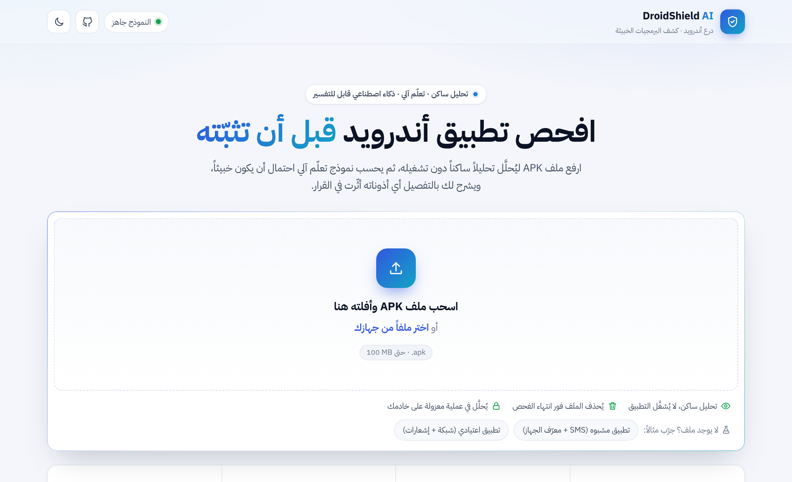
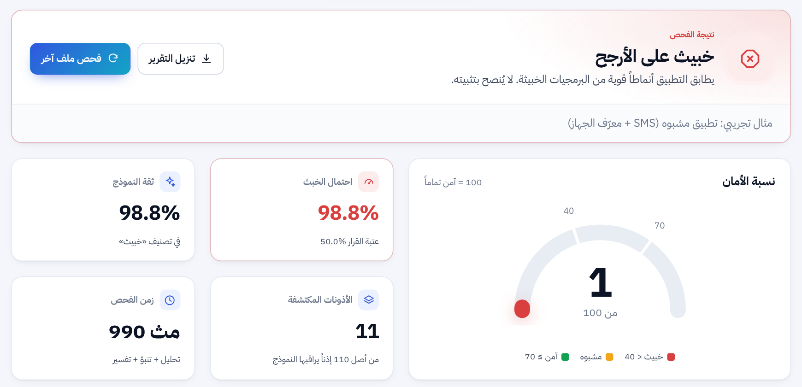
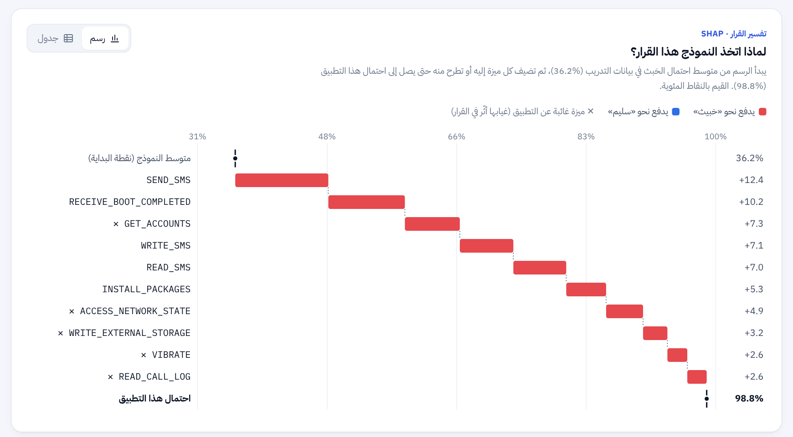

<div dir="rtl">

<div align="center">

# DroidShield AI

**كشف البرمجيات الخبيثة في تطبيقات أندرويد، مع شرح سبب القرار.**

ارفع ملف APK، فيحلّله DroidShield تحليلاً ساكناً، ويقدّر احتمال أن يكون خبيثاً،
ويبيّن لك بالضبط أي الأذونات أثّرت في النتيجة.

[English](README.md)

</div>

<p align="center">
  
</p>

## الفكرة

معظم نماذج كشف البرمجيات الخبيثة تعطيك رقماً فقط، وهذا يصعب الوثوق به أو تصحيح أخطائه.
DroidShield يجمع نموذج تعلّم آلي مع **SHAP**، فتأتي كل نتيجة ومعها تفصيل للميزات التي رفعت الاحتمال أو خفّضته، ومقدار ذلك.

## المزايا

- **تحليل ساكن فقط**: لا يُشغَّل ملف APK أبداً
- **12 وحدة تحليل**: Manifest، الأذونات، المكوّنات، DEX، استدعاءات API الحساسة، النصوص، إعدادات الشبكة، الشهادات، المكتبات الأصلية، الموارد، العتاد، البيانات الوصفية
- **نموذج SVM (نواة RBF) معايَر احتمالياً**، مدرَّب على 110 إذناً
- **تفسير لكل ملف** بقيم SHAP على شكل رسم Waterfall تفاعلي
- **رفع آمن**: حد للحجم، حماية من Zip Bomb، وتحليل في عملية معزولة بمهلة زمنية
- **قفل المخطط**: الخادم يرفض التشغيل إن لم يطابق ترتيب ميزات النموذج ترتيب المحرك (بصمة SHA-256)
- **أداة سطر أوامر** لملف واحد أو مجلد كامل، مع تصدير JSON وNumPy
- **198 اختباراً آلياً**

## لقطات

| النتيجة | التفسير |
|---|---|
|  |  |

## طريقة العمل

```
APK ──► تحميل آمن ──► 12 وحدة تحليل ──► متجه 110 ميزة ──► SVM ──► SHAP ──► النتيجة + التفسير
```

| الطبقة | التقنية |
|---|---|
| التحليل الساكن | Androguard 4.1 مع محلّل Manifest خاص |
| النموذج | scikit-learn `CalibratedClassifierCV(SVC(kernel="rbf"))` |
| التفسير | SHAP `KernelExplainer` |
| الخادم | FastAPI |
| الواجهة | React + Vite |
| النشر | Docker Compose + Nginx |

## النتائج

على بيانات اختبار منفصلة من 683 تطبيقاً (تقسيم طبقي):

| المقياس | SVM | Logistic Regression | الفئة الأغلب |
|---|---|---|---|
| Accuracy | **91.5%** | 87.3% | 67.1% |
| Balanced Accuracy | **90.7%** | 88.1% | 50.0% |
| F1 (خبيث) | **0.873** | 0.824 | 0.000 |
| ROC-AUC | **0.961** | 0.941 | 0.500 |
| إنذار كاذب (FPR) | **7.0%** | 14.4% | — |
| خبيث فائت (FNR) | 11.6% | 9.3% | 100% |

**ملاحظة عن البيانات:** ملف البيانات الأصلي فيه 18,412 صفاً، لكن معظمها مكرّر.
بعد حذف المكرّر والصفوف المتعارضة (نفس الميزات بتصنيفين مختلفين) بقي 3,414 صفاً فريداً.
التدريب على البيانات الخام يعطي أرقاماً أعلى بكثير، لكنها مضخّمة لأن نفس الصفوف تقع في التدريب والاختبار معاً.
الأرقام أعلاه على البيانات بعد التنظيف.

## التشغيل السريع

### عبر Docker (الطريقة المقترحة)

```bash
docker build -t android-malware-xai-backend ./backend
docker build -t android-malware-xai-frontend ./frontend
docker compose up -d
```

- الموقع: http://localhost:8080
- توثيق الـ API: http://localhost:8000/docs

النموذج المدرَّب موجود في المستودع، فلا حاجة للتدريب.

### محلياً

```bash
# الخادم
python -m venv .venv
.venv\Scripts\activate              # على Linux/macOS: source .venv/bin/activate
pip install -r backend/requirements.txt
cd backend && uvicorn app.main:app --port 8000

# الواجهة (في طرفية أخرى)
cd frontend && npm install && npm run dev   # http://localhost:5173
```

على Windows يمكنك تشغيل كل شيء بالأمر `powershell -ExecutionPolicy Bypass -File .\start.ps1`، أو بالضغط على **F5** في VS Code.

### سطر الأوامر

```bash
cd backend
python -m droidshield_engine analyze path/to/app.apk
python -m droidshield_engine batch   path/to/folder
python -m droidshield_engine schema
```

## نقاط الـ API

| النقطة | الوصف |
|---|---|
| `POST /predict` | رفع ملف APK (`multipart/form-data`، الحقل `file`) |
| `POST /predict/features` | إرسال الميزات مباشرة: `{"features": {"SEND_SMS": 1, ...}}` |
| `GET /model/info` | مقاييس النموذج |
| `GET /health` | حالة الخادم |

## إعادة التدريب

ضع الملف `Final_Balanced_Three_Datasets.csv` في مجلد `data/` (غير مرفوع إلى Git)، ثم:

```bash
python backend/ml/train_droidshield.py
```

تُحفظ المخرجات في `backend/models/droidshield/`: النموذج، والمقاييس، وعيّنة SHAP، وبطاقة النموذج مع بصمة المخطط.

## القيود

- النموذج يعتمد على **الأذونات فقط**، وأذونات Android الحديثة غير الموجودة في البيانات لا تدخل في القرار.
- يمكن التهرّب من التحليل الساكن بالتعمية الشديدة أو تحميل الكود ديناميكياً.
- النتيجة تقدير إحصائي، وليست حكماً قاطعاً.

## خطط قادمة

- [ ] إدخال ميزات استدعاءات API والنصوص في النموذج، وليس الأذونات فقط
- [ ] كشف التعمية (إنتروبي النصوص، نسبة الأسماء القصيرة)
- [ ] التدريب على بيانات أكبر وأحدث

## ملاحظات أمنية

- تُحذف الملفات المرفوعة فور انتهاء التحليل.
- لا تحمّل نماذج `joblib` أو `pickle` من مصادر غير موثوقة، فقد تنفّذ كوداً عند التحميل.
- تعامل مع عينات البرمجيات الخبيثة الحقيقية داخل بيئة معزولة (VM) فقط.

## الترخيص

[MIT](LICENSE)

</div>
