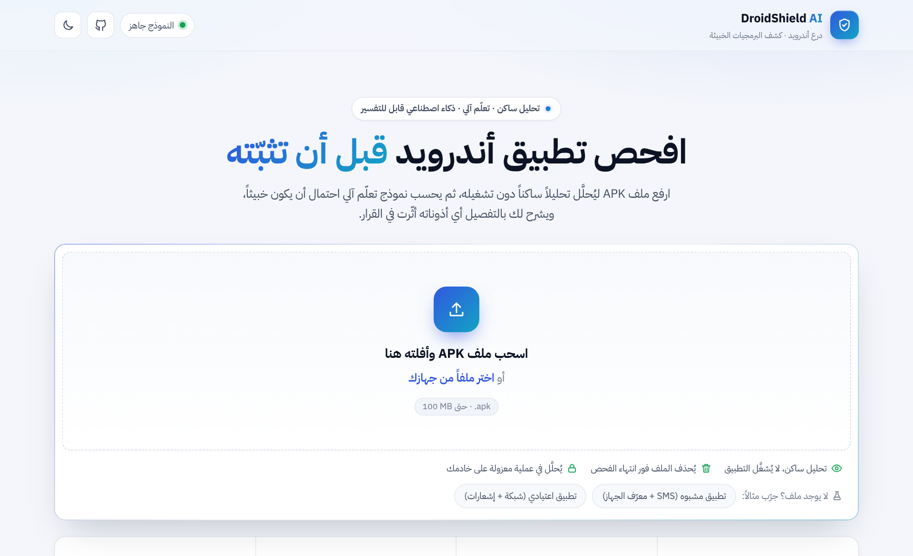
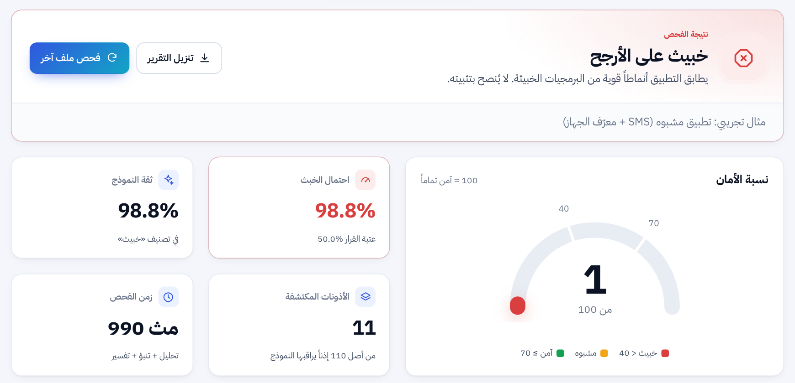
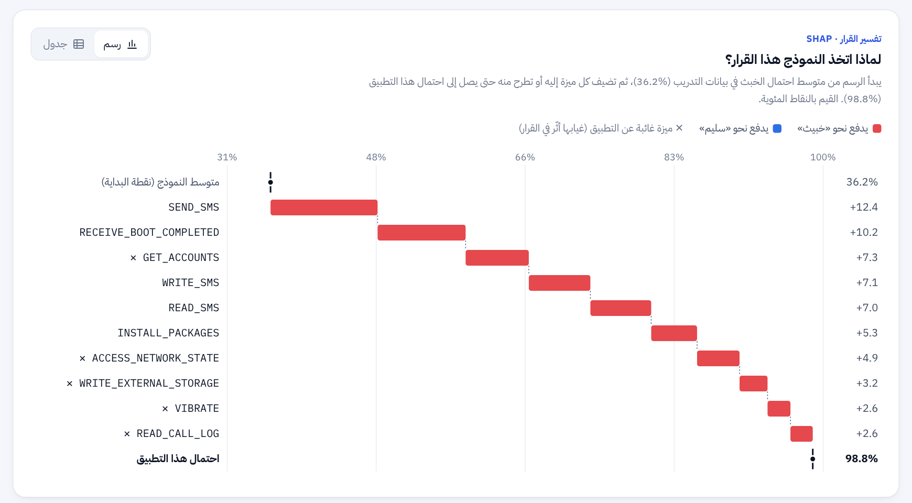

<div align="center">

# DroidShield AI

**Android malware detection that explains its decisions.**

Upload an APK — DroidShield analyzes it statically, estimates how likely it is to be malicious,
and shows exactly which permissions pushed the verdict.


[العربية](README.ar.md)

</div>

<p align="center">
  
</p>

## Why

Most malware classifiers give you a score and nothing else. That is hard to trust and impossible to debug.
DroidShield pairs a classic ML model with **SHAP**, so every result comes with a breakdown of which features
moved the probability up or down — and by how much.

## Features

- **Static analysis only** — the APK is never executed
- **12 analysis modules** — manifest, permissions, components, DEX, sensitive APIs, strings, network config, certificates, native libs, resources, hardware, metadata
- **Calibrated SVM (RBF)** trained on 110 Android permissions
- **Per-file explanations** with SHAP, shown as an interactive waterfall chart
- **Safe upload handling** — size limits, zip-bomb protection, analysis in an isolated process with a timeout
- **Schema lock** — the server refuses to start if the model's feature order doesn't match the engine (SHA-256 fingerprint)
- **CLI** for single files or whole folders, plus JSON / NumPy exports
- **198 automated tests**

## Screenshots

| Verdict | Explanation |
|---|---|
|  |  |

> The interface is in Arabic.

## How it works

```
APK ──► safe loader ──► 12 analyzers ──► 110-feature vector ──► SVM ──► SHAP ──► verdict + explanation
         (zip checks)    (Androguard)     (permission flags)    (calibrated)
```

| Layer | Tech |
|---|---|
| Static analysis | Androguard 4.1, custom manifest parser |
| Model | scikit-learn `CalibratedClassifierCV(SVC(kernel="rbf"))` |
| Explanations | SHAP `KernelExplainer` |
| API | FastAPI |
| Frontend | React + Vite |
| Deployment | Docker Compose + Nginx |

## Results

Evaluated on a held-out, stratified test set of 683 apps:

| Metric | SVM | Logistic Regression | Majority class |
|---|---|---|---|
| Accuracy | **91.5%** | 87.3% | 67.1% |
| Balanced accuracy | **90.7%** | 88.1% | 50.0% |
| F1 (malware) | **0.873** | 0.824 | 0.000 |
| ROC-AUC | **0.961** | 0.941 | 0.500 |
| False positive rate | **7.0%** | 14.4% | — |
| False negative rate | 11.6% | 9.3% | 100% |

**A note on the data.** The source dataset has 18,412 rows, but most of them are duplicates.
After removing duplicates and rows with identical features but conflicting labels, 3,414 unique samples remain.
Training on the raw data gives much higher numbers, but only because the same rows end up in both train and test.
The results above are on the cleaned data.

## Quick start

### Docker (recommended)

```bash
docker build -t android-malware-xai-backend ./backend
docker build -t android-malware-xai-frontend ./frontend
docker compose up -d
```

- App: http://localhost:8080
- API docs: http://localhost:8000/docs

The trained model is included in the repo, so no training step is needed.

### Local

```bash
# backend
python -m venv .venv
source .venv/bin/activate          # Windows: .venv\Scripts\activate
pip install -r backend/requirements.txt
cd backend && uvicorn app.main:app --port 8000

# frontend (new terminal)
cd frontend && npm install && npm run dev   # http://localhost:5173
```

On Windows you can also run everything with `powershell -ExecutionPolicy Bypass -File .\start.ps1`, or press **F5** in VS Code.

### Command line

```bash
cd backend
python -m droidshield_engine analyze path/to/app.apk
python -m droidshield_engine batch   path/to/folder
python -m droidshield_engine schema
```

## API

| Endpoint | Description |
|---|---|
| `POST /predict` | Upload an APK (`multipart/form-data`, field `file`) |
| `POST /predict/features` | Send features directly: `{"features": {"SEND_SMS": 1, ...}}` |
| `GET /model/info` | Model metrics |
| `GET /health` | Health check |

<details>
<summary>Example response</summary>

```json
{
  "label": "malware",
  "malware_probability": 0.996,
  "safety_score": 0.4,
  "threshold": 0.5,
  "active_features": 6,
  "total_features": 110,
  "explanation": {
    "base_value": 0.3623,
    "prediction": 0.996,
    "top_features": [
      { "feature": "SEND_SMS", "shap": 0.165, "direction": "malware" },
      { "feature": "RECEIVE_BOOT_COMPLETED", "shap": 0.086, "direction": "malware" }
    ]
  },
  "elapsed_ms": 970
}
```

</details>

## Retraining

Put `Final_Balanced_Three_Datasets.csv` in `data/` (not tracked in git), then:

```bash
python backend/ml/train_droidshield.py
```

This writes the model, metrics, SHAP background and a model card with the schema fingerprint to `backend/models/droidshield/`.

## Project structure

```
backend/
  droidshield_engine/   static analysis engine (core, analyzers, feature extraction, exporters, tests)
  ml/                   training, dataset cleaning, prediction + SHAP
  app/                  FastAPI server
  models/droidshield/   trained model and metadata
frontend/               React app
docs/                   work report and screenshots
```

## Limitations

- The model only looks at **permissions**. Permissions added in newer Android versions that aren't in the dataset don't affect the result.
- Static analysis can be evaded by heavy obfuscation or dynamic code loading.
- A result is a statistical estimate, not a final judgement.

## Roadmap

- [ ] Use API-call and string features in the model, not just permissions
- [ ] Obfuscation detection (string entropy, short identifier ratio)
- [ ] Train on a larger, more recent dataset

## Security notes

- Uploaded files are deleted right after analysis.
- Never load `joblib` / `pickle` models from untrusted sources — they can execute code.
- Handle real malware samples only inside an isolated VM.

## References

- Arp et al., *DREBIN: Effective and Explainable Detection of Android Malware*, NDSS 2014
- Lundberg & Lee, *A Unified Approach to Interpreting Model Predictions*, NeurIPS 2017
- [Androguard](https://github.com/androguard/androguard) · [SHAP](https://github.com/shap/shap)

## License

[MIT](LICENSE)
